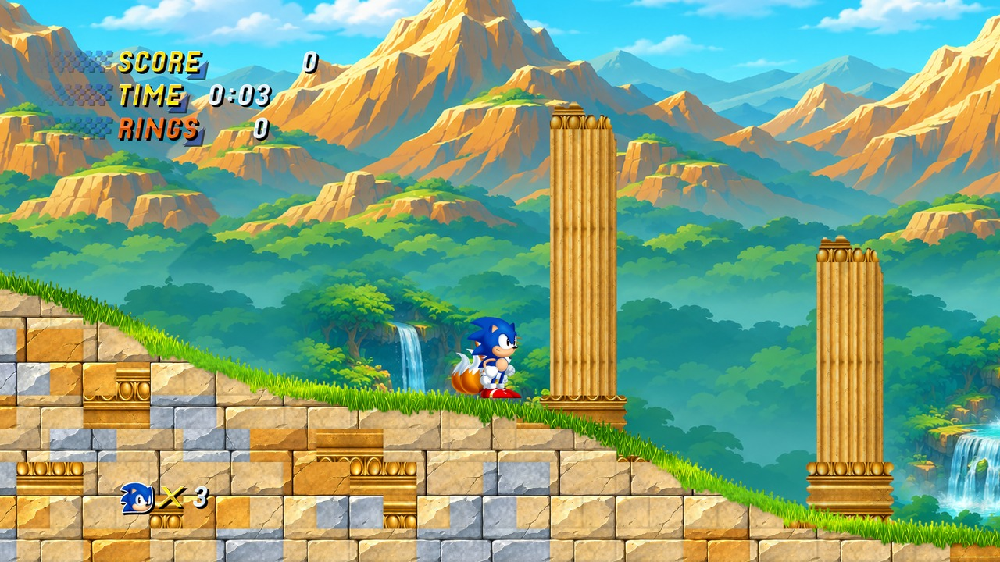
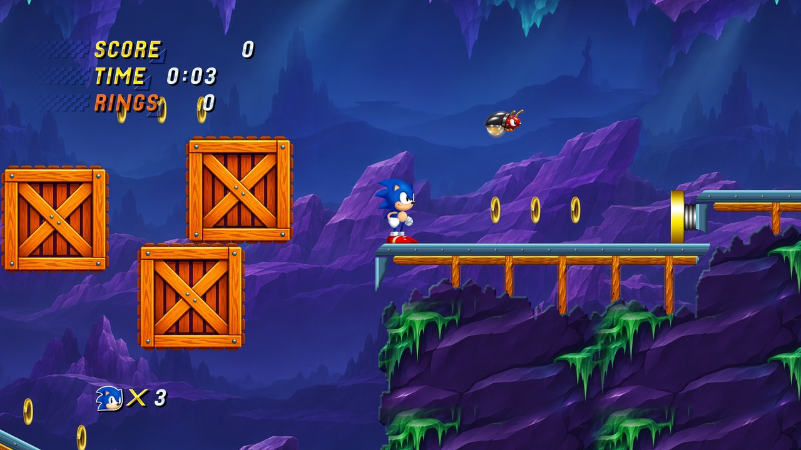
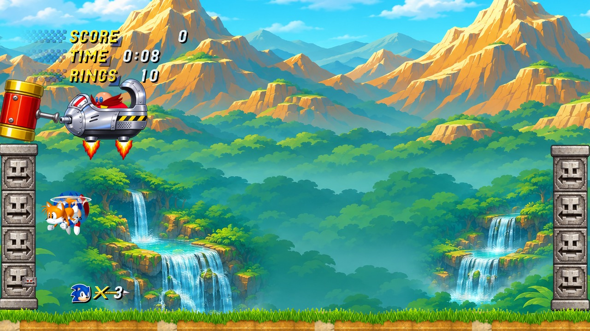
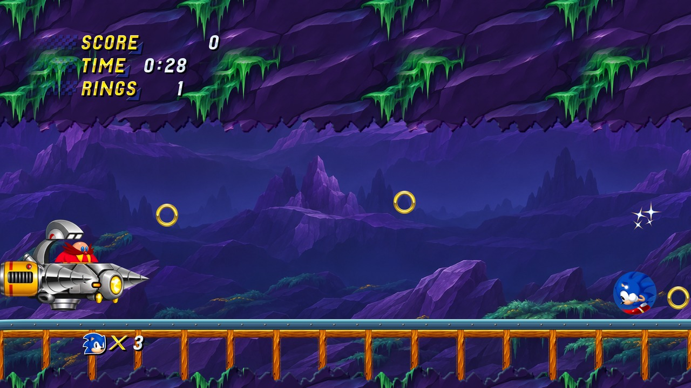

# Sonic 2 HD Demo 2.0 | Unofficial Expansion Patch

**Two more zones for Team S2HD’s Windows demo.** Head into Aquatic Ruin after Chemical Plant, then explore Mystic Cave after Hill Top. Each zone has two acts and its own boss fight. I built the expansion around the routes from the 1992 Mega Drive game. — MagmanPlay

**[Download v1 with instructions (.zip)](https://github.com/MagmanPlay/sonic-2-hd-unofficial-expansion/releases/download/v1/S2HD-Unofficial-Expansion-Patch-v1.zip)** · [Patch only (.xdelta)](https://github.com/MagmanPlay/sonic-2-hd-unofficial-expansion/releases/download/v1/S2HD-Unofficial-Expansion-Patch-v1.xdelta) · [Release notes](CHANGELOG.md)

Requires the original **Sonic 2 HD Demo 2.0 for Windows, build 1012**. [Download the original demo from Team S2HD](https://sonic2hd.com/download/).

| Aquatic Ruin | Mystic Cave |
| --- | --- |
|  |  |
| Stay on the pillars or take the underwater route. Both lead to Eggman and his hammer. | Grab the vines, ride the mine platforms and watch for falling rocks when Egg Digger appears. |

## Install on Windows

1. Download the original game ZIP. Keep it compressed and make a copy named `S2HD-Expansion-v1.zip`. Delta Patcher will modify this copy.
2. Download and extract the **v1 patch ZIP** linked above. Open [Delta Patcher](https://github.com/marco-calautti/DeltaPatcher/releases).
3. In **Original file**, select `S2HD-Expansion-v1.zip`. In **XDelta patch**, select `S2HD-Unofficial-Expansion-Patch-v1.xdelta`. Click **Apply patch**.
4. Extract the patched game ZIP into a fresh folder and run `S2HD.exe`. The title screen will say **Unofficial Expansion Patch v1** beside the demo’s build number.

If Delta Patcher reports a checksum mismatch, start again with a fresh copy of Team S2HD’s ZIP. An archive made by re-zipping an existing installation has different bytes. [SHA-256 checksums](https://github.com/MagmanPlay/sonic-2-hd-unofficial-expansion/releases/download/v1/SHA256SUMS.txt)

## What else changed?

- The camera keeps up with a spin dash across the finish line. Act transitions, checkpoints and the camera after a boss fight have also been reworked.
- The Video menu can follow your display’s refresh rate. The game still runs its physics at 60 ticks per second.
- Speed Shoes switch tempo without restarting the music. Press Enter to finish the end-of-act bonus tally.

See the two new boss fights

| Egg Hammer in Aquatic Ruin | Egg Digger in Mystic Cave |
| --- | --- |
|  |  |

## Credits

**Team S2HD** created Sonic 2 HD, its SonicOrca engine and Demo 2.0. **MagmanPlay** made this independent fan expansion and has no affiliation with SEGA or Team S2HD. Sonic the Hedgehog and the original Sonic the Hedgehog 2 belong to SEGA.

Original zone music by **Masato Nakamura**. Aquatic Ruin uses **eph**’s Act 1 preview arrangement in both acts. Mystic Cave uses the arrangement by **Tee Lopes**. Parts of the expansion artwork, including the Aquatic Ruin canopy, were made with the help of ImageGen. [Team S2HD’s Aquatic Ruin music preview](https://sonic2hd.com/2020/10/18/demo-3-0-ost-aquatic-ruin-zone-act-1/)

Found a bug? Please include the zone, act, route and what you were doing just before it happened. A screenshot or short clip can help pin down the spot. [Report an expansion bug](https://github.com/MagmanPlay/sonic-2-hd-unofficial-expansion/issues)
